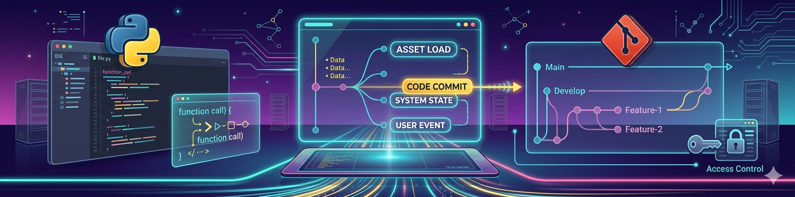

<!-- Banner do Perfil -->

  

<h1 align="center">🗺️ Welcome to Ascension Island</h1>

  Desenvolvedor Fullstack em evolução | Java & Python | Automação | Sistemas de Vendas | IA

---

## 🚀 Developer
Sou um desenvolvedor em constante evolução, apaixonado por criar sistemas úteis — principalmente soluções que realmente melhoram a vida de pessoas e negócios reais.

Hoje estou focado em:

- Desenvolvimento **Java** e **Python**
- Construção de **SaaS** (atualmente: Sistema de Vendas e Estoque)
- Projetos profissionais e freelancing
- Automação para produtividade
- Estruturas sólidas e escaláveis para o futuro
- Inteligência Artificial aplicada ao dia a dia
- LLMs (Large Language Models)
- Automações inteligentes e agentes autônomos
- Integração de IA a sistemas reais (APIs, pipelines, microserviços)

---

## 🛠️ Tech Stack

 

#### 🔴 Back-end & Linguagens

#### 🗄️ Banco de Dados

#### 🤖 Ciência de Dados & ML

#### ⚙️ Ferramentas & DevOps

---

### 🧠 Metodologias & Princípios
* **Agile:** Scrum
* **Qualidade de Código:** Clean Code & Princípios SOLID
* **Testes:** JUnit para Java

---

## 📁 Projetos em Destaque

### 🔹 StockFlow — API RESTful de Gestão de Estoque e Controle de Vendas
API robusta desenvolvida em **Java** com **Spring Boot**, projetada para automatizar e integrar processos logísticos e comerciais de empresas. O sistema gerencia todo o ciclo de vida do inventário — desde o cadastro de produtos, fornecedores e movimentações de estoque até o processamento seguro de vendas e geração de relatórios estratégicos.

#### 💡 Principais Diferenciais Técnicos:
- **Mecanismos Anti-Duplicação (Idempotência):** Garantia de processamento único de requisições de vendas através de `Idempotency-Key`, evitando lançamentos duplicados por instabilidades de rede.
- **Tratamento de Concorrência de Estoque:** Controle rígido de concorrência e trava em transações concorrentes para evitar *overselling* (venda de itens sem saldo real disponível).
- **Valoração e Relatórios:** Cálculo em tempo real da valoração do estoque, métricas de faturamento e relatórios dos produtos mais vendidos.
- **Segurança & Autenticação:** Arquitetura protegida por tokens **JWT** com controle de acesso baseado em papéis de usuários (*RBAC*).
- **Qualidade & DevOps:** Suíte completa de testes de integração (`JUnit 5`), conteinerização com **Docker** e **Docker Compose**, e pipeline de integração contínua (CI/CD).

**Tecnologias:** `Java` • `Spring Boot` • `Spring Data JPA` • `Spring Security` • `PostgreSQL` • `Flyway` • `Docker` • `JUnit 5`

🔗 [Acessar o Repositório do StockFlow](https://github.com/HernandesWolf/StockFlow-H1)
---

## ✨ Sobre meus conteúdos

  

---

## 📫 Como falar comigo
- 💼 Linkedin: https://surl.li/nyzpgj
- 🐦 X: https://x.com/H_Tech3
- 🐺 GitHub draft: https://github.com/HernandesLobo   
- 📹 YouTube: https://www.youtube.com/@HernandesFullStack

- 📧 Email para contato profissional: jussier30_04@hotmail.com
---

  

🚀 Construindo o futuro, um commit de cada vez.

